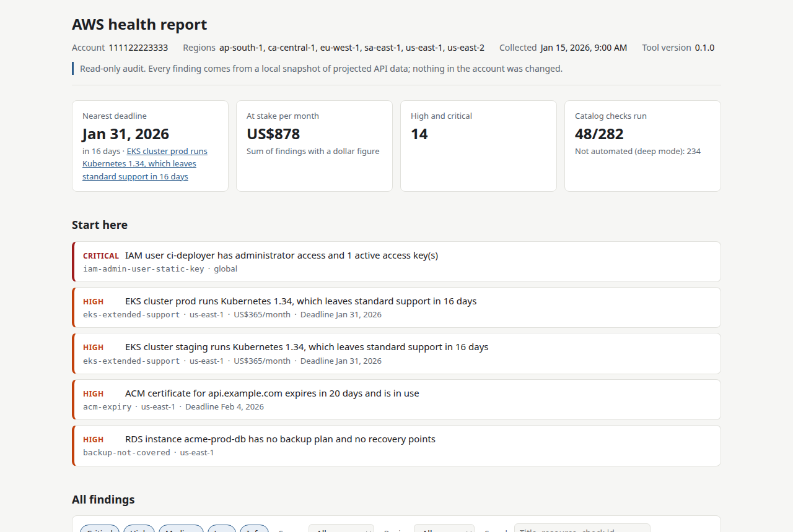

<h1 align="center">claude-aws-health</h1>

<p align="center">
  <b>Find the AWS problems that turn into bills, outages and incidents before they do.</b><br>
  Deadlines in dollars, forgotten resources, alarms nobody receives, backups that never run.<br>
  Every finding comes with evidence, a price and read-only commands to check it yourself.
</p>

<p align="center">
  <a href="https://github.com/kbrianps/claude-aws-health/actions/workflows/ci.yml"></a>
  <a href="LICENSE"></a>
  
  
</p>

<p align="center">
  
</p>

## Why

Most AWS scanners tell you a setting is wrong. They rarely tell you that a cluster starts costing six times more on a date next week, that the nightly database backup has never run because the plan looks for the tag `Backup` and the database has `Bakcup`, or that a dozen production alarms notify an SNS topic with zero subscribers.

`awshealth` was born from a real audit of a production account where all three of those were true at the same time. It looks for exactly this kind of problem: the quiet ones that only show up on the bill or during an incident.

It is built to be trusted with a real account:

- **Read-only, enforced three times.** An IAM role with an explicit deny, an exact allowlist of API operations inside the collector, and an optional guard hook for the AI layer.
- **The AI never holds your credentials.** You run `awshealth collect` yourself. Claude only reads the resulting snapshot, challenges each finding with a skeptic agent and writes the report.
- **Evidence or it did not happen.** Every finding points at the API data behind it, every dollar figure shows its formula and source, and every finding ships with `aws` CLI commands that re-check it.
- **Unknown is not "OK".** When a call is denied or throttled, the report says so instead of showing a clean result.

## What it finds

34 deterministic checks, grouped by where you would notice the problem.

| Where it hurts | Checks |
|---|---|
| **The bill jumps on a date** | EKS clusters leaving standard support (`+US$365/cluster-month`), RDS and Aurora extended support, Lambda runtimes that will block deploys |
| **Data you think is backed up** | Backup plans whose tag selection matches nothing (with typo detection on tag keys), stateful resources outside any backup plan, RDS with 1-day retention, single-AZ or unencrypted |
| **Alarms and jobs that fail silently** | Alarms sending to SNS topics nobody subscribes to, EventBridge rules pointing at deleted Lambdas, queues without a dead-letter queue, alarms stuck for weeks, certificates about to expire |
| **Ways in** | DNS records pointing at AWS IPs you no longer own (subdomain takeover), buckets "protected" only by a spoofable Referer, admin users with years-old access keys, console users without MFA, roles trusting other accounts with admin and no external ID, Lambda URLs with no auth, admin ports open to the internet |
| **Nobody watching** | GuardDuty, Config, Access Analyzer and Security Hub off where workloads run, open regions with no detection, no budgets or anomaly monitors |
| **Paying for nothing** | Unattached volumes, orphan snapshots, idle Elastic IPs, load balancers with no targets, instances stopped for months, logs that never expire, gp2 volumes, every billed public IPv4 |

Beyond those, a catalog of **282 health checks** across 8 domains, each with detection steps, sources and known false-positive traps, drives the optional deep mode. `awshealth catalog` shows which ones are automated and which ones the agent covers.

## Try it in 30 seconds, no AWS account needed

```bash
uvx --from git+https://github.com/kbrianps/claude-aws-health awshealth demo --out ./awshealth-demo
open ./awshealth-demo/report.html
```

The demo runs the full pipeline on "Acme Cameras", a fictional account with a deadline cliff, a backup plan that never ran, a dangling DNS record, a public bucket, alarms that notify nobody, a prompt-injection attempt hidden in a tag (rendered as inert text) and a skeptic pass that kills a false positive with evidence. Use `--lang pt-BR` for the Portuguese report.

## Use it on your account

**1. Create the audit role** (once per account). [`iam/audit-role.cfn.yaml`](iam/audit-role.cfn.yaml) creates `AWSHealthAuditRole` with `SecurityAudit` + `ViewOnlyAccess` and an explicit deny on data-plane reads, credential minting, secret-bearing config and billed calls.

```bash
aws cloudformation deploy --template-file iam/audit-role.cfn.yaml --stack-name aws-health-audit \
  --capabilities CAPABILITY_NAMED_IAM --parameter-overrides TrustedPrincipalArn=<your-user-or-sso-role-arn>
```

Point a profile at it in `~/.aws/config` (`role_arn` + `source_profile`, or an SSO permission set with the same policies).

**2. Install and collect.**

```bash
pipx install git+https://github.com/kbrianps/claude-aws-health   # or: uv tool install git+https://...
awshealth collect --profile aws-health-audit                     # add --cost for Cost Explorer (US$0.01/request)
awshealth check
awshealth render --lang en                                       # or --lang pt-BR
```

**3. Open the report.** Runs live outside your repositories, in `~/.local/share/awshealth/runs/<timestamp>/` (mode 0700):

| File | What it is |
|---|---|
| `report.html` | Single-file report: start-here list, filters, evidence, owner questions, coverage. Works offline, no external requests |
| `report.md` | The same in Markdown |
| `deadlines.ics` | Every future deadline as a calendar event with a 7-day reminder |
| `owner-questions.md` | Findings where the right action depends on intent ("is this Elastic IP allowlisted by a partner?") |
| `coverage.md` | Which of the 282 catalog checks ran, and which could not (denied, throttled, not collected) |
| `findings.ocsf.json` | OCSF Detection Findings for your SIEM |
| `ledger.jsonl` | One line per API call made during collection |

Already run Prowler or AWS Cost Optimization Hub? Import their exports so everything lands in one ranked list:

```bash
awshealth import prowler-output.ocsf.json
awshealth import coh-recommendations.json
```

## With Claude Code

```
/plugin marketplace add kbrianps/claude-aws-health
/plugin install aws-health@kbrianps
```

Start Claude Code with the guard on, then ask for an audit:

```bash
AWSHEALTH_GUARD=strict AWSHEALTH_PROFILE=aws-health-audit claude
> /aws-health:audit
```

The skill walks you through it: you run `awshealth collect` yourself (with the `!` prefix, so the credentials stay with you), Claude runs the checks, sends the high-risk and high-dollar findings to a **skeptic agent** that has no shell and no AWS access and may only confirm, downgrade, kill with evidence or turn a finding into a question for the owner, and then writes the report in your language with the 3-5 actions that matter first.

**Deep mode** (`AWSHEALTH_GUARD=deep`, opt-in) lets Claude also run read-only `aws` commands to cover catalog checks that are not automated yet, split by domain across parallel agents, each followed by a blind skeptic. See [docs/deep-mode.md](docs/deep-mode.md).

The skill follows the open [Agent Skills](https://agentskills.io) format, so `skills/aws-health` also works in other agents that load skills. The guard hook is Claude Code specific; the IAM role is the boundary everywhere.

## How it stays read-only

| Layer | What it stops |
|---|---|
| IAM role (`iam/`) | Any write, data-plane reads (`s3:GetObject`, `ssm:GetParameter`, `secretsmanager:GetSecretValue`, log events), credential minting (`ecr:GetAuthorizationToken`, `sts:GetSessionToken`), secret-bearing config (`lambda:GetFunction`, `cloudformation:GetTemplate`) and billed calls |
| Exact allowlist in the collector | Any API operation not declared by a check, refused before the request is signed. A CI test fails if any check declares a mutating operation |
| Projection | Each call keeps only the fields its check reads. UserData, environment variables and secrets never reach disk |
| Guard hook (`AWSHEALTH_GUARD`) | Reading `~/.aws`, `.env`, Terraform state or private keys, dumping the environment, `--debug`, other profiles, boto3 one-liners, WebFetch and `curl` during an audit, and (in strict mode) any direct `aws` call |
| Untrusted text | Tag values, names and descriptions are escaped and treated as data, never as instructions |

Full threat model, including what this does not protect against: [docs/threat-model.md](docs/threat-model.md).

## Adding a check

A check is one Python module with a declared projection, a function over the snapshot and a test file with a positive, a false-positive and a quiet case. No AWS account needed to write or test it. See [DESIGN.md](DESIGN.md) and [CONTRIBUTING.md](CONTRIBUTING.md); [`awshealth/checks/eks_extended_support.py`](awshealth/checks/eks_extended_support.py) is the reference.

## Roadmap

- More catalog checks automated (CloudTrail-based abandonment signals, Savings Plans coverage, cross-AZ traffic, quotas near their limit)
- Multi-account collection through AWS Organizations
- An MCP server exposing `scan`, `diff` and `explain` for agents without hooks
- Weekly diff mode: what changed since the last run

## License

MIT. Not affiliated with Amazon Web Services or Anthropic.
